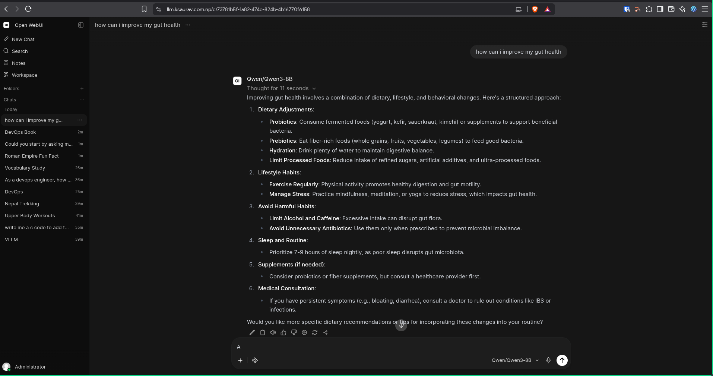
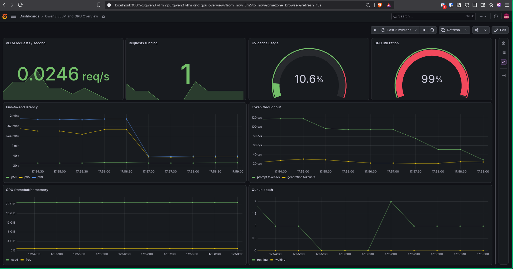
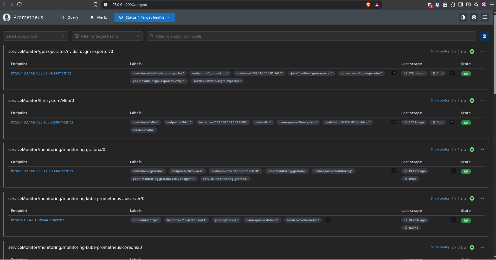
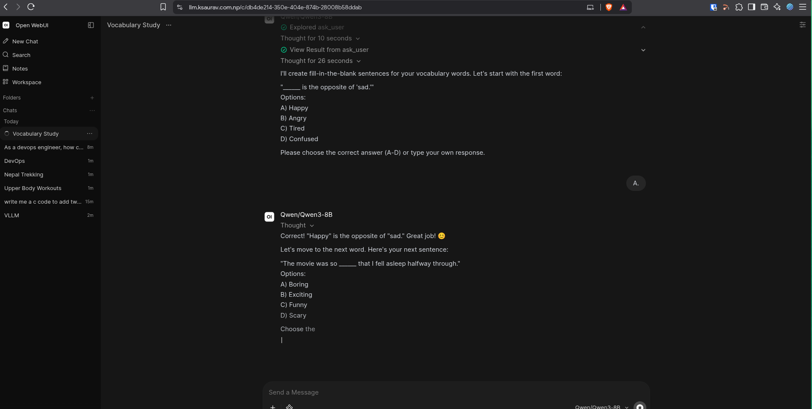

# Visual Verification Evidence

These screenshots record the Azure and Kubernetes deployment that was runtime
verified on 2026-09-30 and later destroyed. They complement the command output
and measured values in [`docs/runtime-evidence.md`](../docs/runtime-evidence.md).

> [!IMPORTANT]
> This is historical, point-in-time evidence. It does not show that the service
> is currently available, and dashboard values are not reproducible benchmark
> results.

> [!CAUTION]
> `image1.jpg` and `image2.jpg` contain Azure account-identifying metadata.
> Redact that metadata before publishing the screenshots outside a controlled
> portfolio or review context. The public IP addresses and hostname visible in
> the set belonged to the destroyed lab deployment and must not be treated as
> stable endpoints.

## Highlights

| End-to-end inference | GPU load during inference |
| --- | --- |
|  |  |

| Prometheus target health | Interactive tool use |
| --- | --- |
|  |  |

## Evidence Index

### Azure Infrastructure

| Image | What it demonstrates | Scope and caveats |
| --- | --- | --- |
| [`image1.jpg`](image1.jpg) | Azure listed the control-plane and GPU-worker VMs as Running, with the intended VM families and public addresses. | Portal snapshot only; contains account metadata and historical public IPs. |
| [`image2.jpg`](image2.jpg) | The East Asia resource group contained the VM, disk, NIC, NSG, public-IP, and virtual-network resources for the lab. | Partial portal viewport; contains account and subscription metadata. |

### Kubernetes Platform

| Image | What it demonstrates | Scope and caveats |
| --- | --- | --- |
| [`image4.jpg`](image4.jpg) | Calico controller, node, and Typha pods were Running across the two nodes. | Lens view of the `calico-system` namespace. |
| [`image7.jpg`](image7.jpg) | The first portion of the all-namespace pod inventory was healthy, including cert-manager, Envoy Gateway, GPU Operator, and core control-plane workloads. | Lens viewport; continued in `image8.jpg`. |
| [`image8.jpg`](image8.jpg) | The remaining all-namespace pod inventory was healthy, including vLLM, local-path storage, and Open WebUI. | Continuation of `image7.jpg`. |
| [`image9.jpg`](image9.jpg) | Fourteen deployments reported their desired replicas Running. | Lens deployment view. |
| [`image20.jpg`](image20.jpg) | `kubectl get all --all-namespaces` showed running pods and the first portion of the service inventory. | Terminal snapshot; service output continues below the viewport. |
| [`image21.jpg`](image21.jpg) | `kubectl get deploy --all-namespaces` showed all listed deployments Available. | Command-line corroboration of the Lens deployment view. |
| [`image22.jpg`](image22.jpg) | `kubectl get pods -A` showed the complete workload set Running or successfully Completed. | Point-in-time pod health, not a long-duration stability test. |

### GPU And Model Serving

| Image | What it demonstrates | Scope and caveats |
| --- | --- | --- |
| [`image5.jpg`](image5.jpg) | The vLLM pod was Running on the GPU worker. | Scheduling and pod-health evidence only. |
| [`image10.jpg`](image10.jpg) | GPU Operator components were Running and the CUDA validator had Succeeded. | Demonstrates operator health, not raw CUDA benchmark performance. |
| [`image13.jpg`](image13.jpg) | vLLM logs recorded successful health checks and `/v1/chat/completions` requests with live throughput and KV-cache metrics. | Runtime log sample; values are not benchmark results. |
| [`image15.jpg`](image15.jpg) | A later vLLM log window recorded concurrent successful requests, generation throughput, cache use, and prefix-cache hits. | Runtime log sample under interactive traffic. |

### Public Edge And Open WebUI

| Image | What it demonstrates | Scope and caveats |
| --- | --- | --- |
| [`image3.jpg`](image3.jpg) | The Open WebUI sign-in page loaded through the public HTTPS hostname. | Browser evidence of TLS/edge reachability at capture time. |
| [`image6.jpg`](image6.jpg) | The Open WebUI StatefulSet pod was Running on the GPU worker. | Pod-health evidence only. |
| [`image11.jpg`](image11.jpg) | Open WebUI submitted a prompt to the selected `Qwen/Qwen3-8B` model and displayed an active generation state. | In-progress request. |
| [`image12.jpg`](image12.jpg) | Qwen3-8B completed the prompt through Open WebUI. | Basic end-to-end inference proof. |
| [`image14.jpg`](image14.jpg) | The model returned formatted C source code and usage instructions. | Demonstrates structured Markdown/code rendering. |
| [`image16.jpg`](image16.jpg) | The model returned a multi-section fitness response. | Demonstrates a longer generated response. |
| [`image17.jpg`](image17.jpg) | The model used the `query_knowledge_files` tool before returning trekking recommendations. | Tool-use UI evidence; not an evaluation of factual quality. |
| [`image18.jpg`](image18.jpg) | The model returned a concise DevOps explanation. | Additional end-to-end inference sample. |
| [`image19.jpg`](image19.jpg) | The model returned a structured LLMOps/MLOps learning path. | Additional long-form inference sample. |
| [`image23.jpg`](image23.jpg) | Open WebUI displayed a completed `ask_user` tool call and its result during a vocabulary workflow. | The expanded reasoning panel is diagnostic UI, not an API contract. |
| [`image24.jpg`](image24.jpg) | The model consumed the user's tool-assisted answer, confirmed it, and continued the exercise. | Demonstrates a multi-turn tool interaction. |
| [`image34.jpg`](image34.jpg) | Qwen3-8B returned a complete health-information response through the public Open WebUI endpoint. | Final end-to-end functional sample; not medical validation. |

### Observability

| Image | What it demonstrates | Scope and caveats |
| --- | --- | --- |
| [`image25.jpg`](image25.jpg) | Grafana, Prometheus, kube-state-metrics, node-exporter, and operator services were Active in the monitoring namespace. | Lens service view. |
| [`image26.jpg`](image26.jpg) | Community dashboard `vLLM Monitoring - V2` displayed success, active requests, latency, throughput, and prompt-length data for Qwen3-8B. | Upper dashboard section under live traffic. |
| [`image27.jpg`](image27.jpg) | The same dashboard displayed cache, scheduler, memory, finish-reason, and request-success data. | Lower dashboard section under live traffic. |
| [`image28.jpg`](image28.jpg) | Community dashboard `vLLM Metrics` displayed token, queue, prompt, and time-to-first-token series. | One panel reported no data in the captured interval. |
| [`image29.jpg`](image29.jpg) | Repository dashboard `Qwen3 vLLM and GPU Overview` combined request, latency, throughput, queue, cache, and framebuffer data. | Captured between GPU work intervals. |
| [`image30.jpg`](image30.jpg) | Prometheus showed UP targets for DCGM exporter, vLLM, Grafana, the API server, and additional cluster components. | Representative viewport of the target list; the complete 18/18 count is recorded in runtime evidence. |
| [`image31.jpg`](image31.jpg) | The Node Exporter dashboard displayed control-plane CPU, load, memory, disk, and filesystem data. | Host telemetry sample. |
| [`image32.jpg`](image32.jpg) | The Kubernetes cluster dashboard displayed aggregate CPU and memory utilization, commitments, and namespace usage. | Cluster telemetry sample. |
| [`image33.jpg`](image33.jpg) | The repository dashboard captured 99% GPU utilization alongside active requests, token throughput, latency, cache, memory, and queue depth. | Load snapshot, not a controlled benchmark. |

## What The Screenshots Do Not Prove

- They do not replace the textual acceptance checks in
  [`docs/runtime-evidence.md`](../docs/runtime-evidence.md).
- They do not establish sustained throughput, latency percentiles under a
  controlled workload, availability, recovery time, or production readiness.
- They do not prove that every dashboard panel or every external integration was
  configured correctly beyond the captured viewport and time window.
- Lens was used to inspect resources, but a separate final Lens acceptance pass
  was not completed before teardown.
