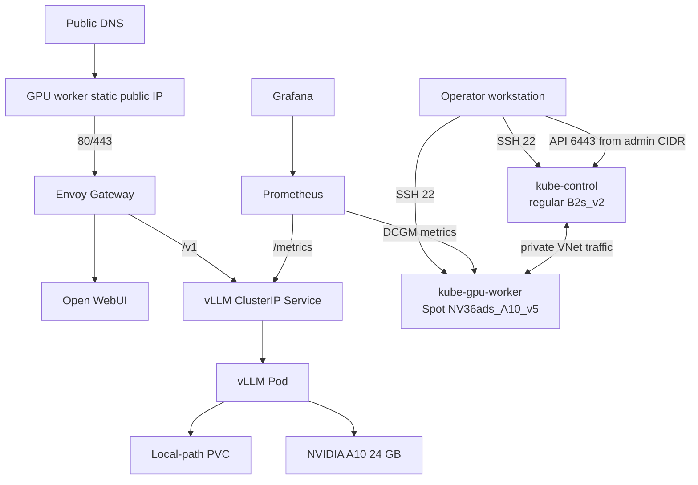
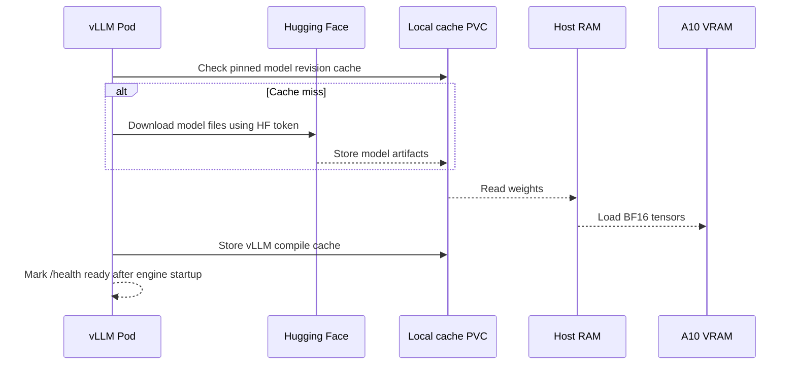

# Architecture

## System Goal

Serve the immutable `Qwen/Qwen3-8B` model through vLLM's OpenAI-compatible API
on one NVIDIA A10 GPU, while exposing enough of the infrastructure stack to teach
cloud networking, Linux configuration, Kubernetes bootstrap, GPU enablement,
storage, model serving, security, observability, and cost control.

This is intentionally a self-managed Kubernetes lab. Managed Kubernetes would
remove much of the control-plane and node-bootstrap work that this project is
designed to demonstrate.

## Architecture At A Glance



The public edge, UI, and monitoring components shown here were runtime verified
on 2026-09-30.

## Layer Ownership

| Layer | Tool | State Owned | Why It Owns This Layer |
| --- | --- | --- | --- |
| Azure infrastructure | Terraform | Resource group, VNet, subnet, NSGs, public IPs, NICs, VMs, disks | Terraform models cloud resources as a dependency graph and previews changes before mutation. |
| Host operating system | Ansible | Packages, kernel modules, sysctls, containerd, Kubernetes binaries, NVIDIA driver/toolkit | These are machine-level settings outside the Kubernetes API. Ansible makes them convergent and reviewable. |
| Cluster bootstrap | kubeadm through Ansible | PKI, control-plane static pods, kubeconfigs, join tokens, kubelet registration | kubeadm provides supported Kubernetes bootstrap primitives without hiding control-plane mechanics. |
| Pod networking | Calico Operator | CNI, pod address pool, overlay network, NetworkPolicy engine | Kubernetes requires a CNI before nodes become Ready and pods can communicate. |
| Local dynamic storage | local-path-provisioner | StorageClass, local PV directories, helper pods | It gives the lab a simple dynamic PVC without adding a cloud CSI dependency. |
| GPU integration | NVIDIA GPU Operator | Node discovery, device plugin, validation, DCGM metrics | Kubernetes cannot schedule a GPU until a device plugin advertises `nvidia.com/gpu`. |
| Model serving | Helm and vLLM | Deployment, Service, PVC, ServiceAccount, optional ServiceMonitor | Helm packages related Kubernetes objects and exposes environment-specific values. |
| Edge, TLS, UI | Envoy Gateway, cert-manager, Open WebUI | Public routing, certificates, browser UI, and UI-local state | These concerns belong above the internal model service and should not be mixed into the inference container. |
| Observability | Prometheus, Grafana, DCGM | Metrics collection, local retention, and dashboards | Monitoring observes the system without becoming part of request execution. |

Clear ownership avoids two tools fighting over the same state. For example,
Ansible owns the NVIDIA driver and toolkit, so GPU Operator has
`driver.enabled=false` and `toolkit.enabled=false`.

## Infrastructure Topology

### Resource Group

All Azure resources live in one resource group. This makes inventory and eventual
lab cleanup simple, but it also gives resource-group deletion a large blast
radius. Production environments commonly separate shared networking, clusters,
data, and monitoring into independently governed resource groups.

### Virtual Network And Subnet

The VNet is `10.42.0.0/16`; the node subnet is `10.42.0.0/24`. The control plane
uses `10.42.0.10`, and the worker uses `10.42.0.20`. Static private addresses are
important because kubeadm advertises the control-plane endpoint and Ansible uses
the addresses as inventory facts.

Pod addresses use `192.168.0.0/16`, while Kubernetes Services use
`10.96.0.0/12`. These ranges must not overlap each other, the VNet, connected
networks, or networks used by administrators. Overlap produces routing failures
that can look like DNS or application bugs.

### Public Exposure

Both VMs have Standard static public IPs for this learning environment. The
control-plane NSG allows SSH and TCP 6443 only from one administrator `/32`. The
worker NSG allows SSH from that `/32` and public HTTP/HTTPS for the deployed
gateway. Internal VNet traffic is broadly allowed between VNet addresses.

An open NSG port is not an application. Port 443 does nothing until a process is
listening, a Kubernetes Service maps traffic, a gateway routes it, and a valid TLS
certificate exists.

Production should normally remove direct node public IPs, use private cluster
endpoints, and place public traffic behind a managed load balancer, WAF, or other
controlled edge.

### Azure And Linux Forwarding

Terraform enables Azure NIC IP forwarding. Ansible separately enables Linux
`net.ipv4.ip_forward`. Both layers matter:

- Azure NIC forwarding tells the cloud fabric that the VM may route packets not
  addressed directly to its primary NIC address.
- Linux forwarding tells the kernel to forward those packets.
- Calico then creates interfaces, routes, encapsulation, and policy behavior for
  pod traffic.

Missing any one layer can break cross-node pod networking.

## Kubernetes Control Plane

The control plane runs kube-apiserver, scheduler, controller manager, etcd, and
CoreDNS-related cluster services. kubeadm writes static pod manifests under
`/etc/kubernetes/manifests`; kubelet keeps those components running.

This topology has one control-plane node and stacked etcd. It teaches component
relationships but has no control-plane high availability. Losing the VM or etcd
disk makes cluster management unavailable, even if an existing worker container
continues briefly.

The API advertises the private control-plane address. The certificate SANs include
that private address and the inventory hostname, not the public address. This
reduces accidental public-endpoint dependence. Administration should use private
routing or an SSH tunnel instead of changing kubeconfig to an address absent from
the certificate.

## Container Runtime Path

```text
Kubernetes Deployment
  -> scheduler assigns Pod to kube-gpu-worker
  -> kubelet asks containerd through CRI
  -> containerd creates the container
  -> NVIDIA CDI/device integration injects GPU devices and libraries
  -> vLLM starts and loads model weights onto the GPU
```

containerd and kubelet both use the systemd cgroup driver. Matching cgroup
drivers matters because two managers trying to organize processes differently
can cause unstable resource accounting and node behavior.

## Pod Network Path

Calico uses a VXLAN overlay with BGP disabled. A pod receives an address from
`192.168.0.0/16`. Cross-node pod packets are encapsulated for transport across
the Azure VNet. Outbound pod traffic is source-NATed when leaving the cluster.

VXLAN is straightforward for a small self-managed cloud cluster because Azure
does not need routes for every pod address. The tradeoff is encapsulation overhead
and an additional network layer to diagnose. A larger production environment may
prefer a cloud-integrated CNI or deliberately designed routed networking.

## GPU Scheduling Path

The host driver communicates with the physical A10. NVIDIA Container Toolkit
integrates GPU devices with containerd. Node Feature Discovery identifies NVIDIA
hardware. The NVIDIA device plugin advertises one extended resource named
`nvidia.com/gpu`. The vLLM pod requests a limit of one, so the scheduler can place
it only where that resource is free.

The custom `accelerator=nvidia-gpu` label narrows placement before resource
allocation. The label describes intended placement; `nvidia.com/gpu` proves the
device plugin has registered actual allocatable hardware. Both should be checked.

## Model And Cache Data Flow



The PVC persists Hugging Face and vLLM compile caches across pod restarts. It is
local to the GPU worker, so it does not survive worker disk loss. Cache data is
reproducible from the pinned model revision; user or application data must not be
stored there without a separate durability design.

## Request Data Flow

The vLLM Service remains internal `ClusterIP`. Public traffic reaches the worker's
ports 80/443, which Kubernetes maps to Envoy's unprivileged container ports
10080/10443. Envoy terminates TLS and routes `/v1` to vLLM while routing `/` to
Open WebUI. Grafana remains private and is accessed with `kubectl port-forward`.

vLLM checks the bearer API key. This is application authentication, not full
identity management. A production API also needs key rotation, rate limiting,
tenant isolation, audit logging, abuse controls, request-size limits, and a policy
for prompts and generated data.

## State And Failure Domains

| State | Location | Survives Pod Restart | Survives Worker Loss | Backup Today |
| --- | --- | --- | --- | --- |
| Terraform state | Operator workstation | N/A | Yes, if workstation data survives | No remote backend yet |
| Kubernetes/etcd state | Control-plane OS disk | Yes | N/A | Not yet configured |
| Admin kubeconfig | Control-plane user home | Yes | N/A | Not copied into repository |
| Model and compile cache | Worker local PVC/OS disk | Yes | No | Re-downloadable |
| Container images | Worker runtime storage | Yes | No | Re-pullable |
| API secrets | Kubernetes etcd | Yes | N/A | No external secret manager yet |
| Open WebUI accounts/conversations | Worker-local 5 GiB PVC | Yes | No | No backup yet |
| Prometheus metrics | Worker-local 20 GiB PVC | Yes | No | Seven-day/15 GB retention, no external copy |
| Grafana state | Worker-local 5 GiB PVC | Yes | No | Dashboard source is version-controlled; UI state is not backed up |
| Benchmark evidence | Planned repository artifacts | N/A | Yes after publishing | Not yet produced |

The major failure domains are one control-plane VM, one Spot GPU VM, one local
disk, one GPU, and one model replica. Kubernetes can restart a failed container;
it cannot create unavailable hardware or reconstruct lost local data by itself.

## Trust Boundaries

| Boundary | Sensitive Capability | Current Control |
| --- | --- | --- |
| Operator to Azure | Create billable cloud resources | Azure credentials and explicit apply gate |
| Internet to nodes | Reach SSH, API, or web ports | Role-specific NSGs and administrator `/32` |
| Operator to nodes | Root-equivalent host configuration | SSH key plus Ansible privilege escalation |
| User to Kubernetes API | Full cluster administration | Root-owned/admin-user kubeconfig with mode `0600` |
| Pod to GPU | Direct hardware access | GPU extended-resource allocation and device plugin |
| vLLM to Hugging Face | Model repository access | Kubernetes Secret injected as environment variable |
| Client to vLLM | Inference API access | Public TLS plus bearer API key on `/v1` |
| Browser to Open WebUI | Accounts, prompts, and conversations | Public TLS and Open WebUI local authentication |
| Operator to Grafana | Cluster and inference telemetry | Private ClusterIP, kubectl authorization, and Grafana credentials |

## Why This Architecture Is Useful For Learning

The project exposes boundaries a managed platform normally hides: cloud routing,
node preparation, CRI, CNI, PKI, device plugins, storage provisioning, scheduling,
health probes, and inference parameters. The correct lesson is not that every
production team should self-manage all of them. The lesson is how to identify
ownership, dependencies, evidence, failure modes, and operational cost when
choosing between self-managed and managed services.
