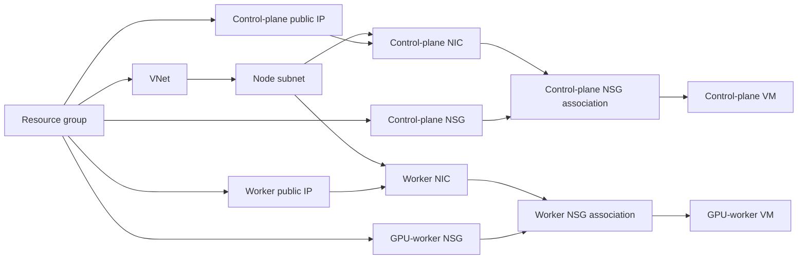

# Azure Infrastructure With Terraform

## Purpose And Boundary

This directory declares the Azure infrastructure for a two-node kubeadm learning
cluster in East Asia. Terraform owns Azure resources only. It does not configure
Linux, install Kubernetes, join nodes, or deploy workloads; Ansible and Kubernetes
own those layers.

This separation matters because each tool has a different reconciliation model:

- Terraform compares desired cloud resources with Azure and Terraform state.
- Ansible converges mutable operating-system configuration over SSH.
- Kubernetes controllers converge API objects inside the cluster.

Do not place package installation or application secrets in Terraform merely
because Terraform can run scripts. Keeping boundaries explicit makes plans easier
to review and failures easier to locate.

## Current Status

- Configuration is formatted and passes `terraform validate`.
- The approved saved plan showed 13 creates, 0 updates, and 0 deletes.
- That exact plan was applied successfully on 2026-09-30.
- Azure quota was approved for the Spot GPU and regular control-plane pools.
- Local Terraform state is the authoritative mapping for the live lab resources.

Always generate a fresh plan before a future change. A saved plan can become stale
when configuration, credentials, provider state, prices, or Azure capacity change.

## File Map

| File | Responsibility |
| --- | --- |
| `versions.tf` | Terraform and AzureRM provider version contract |
| `variables.tf` | Typed environment inputs and validation |
| `locals.tf` | Shared resource tags |
| `network.tf` | Resource group, VNet, subnet, NSGs, public IPs, NICs, associations |
| `compute.tf` | Control-plane and GPU-worker VMs |
| `outputs.tf` | Addresses and operator convenience values |
| `terraform.tfvars.example` | Non-secret example inputs |
| `.terraform.lock.hcl` | Selected provider checksums and versions |

## Terraform And Provider Contract

`versions.tf` accepts Terraform `>= 1.15.0, < 1.17.0` and pins AzureRM exactly
to `5.7.0`. The Terraform range permits compatible CLI patch/minor releases; the
exact provider pin prevents provider schema or behavior from drifting between
runs.

The provider block contains no credentials. Authentication comes from an
AzureRM-supported external mechanism such as Azure CLI or environment variables.
This avoids committing credentials, but the operator must verify the active
subscription and tenant before planning.

```bash
az account show --output table
```

Why this check matters: valid credentials for the wrong subscription can still
produce a valid plan and expensive resources in the wrong account.

## Declared Resources

The default configuration declares 13 resources.

| Resource | Count | Purpose | Important Consequence |
| --- | ---: | --- | --- |
| Resource group | 1 | Lifecycle and ownership boundary | Deleting it removes all contained lab resources. |
| Virtual network | 1 | Private address space `10.42.0.0/16` | Connected networks must not overlap. |
| Node subnet | 1 | Node addresses in `10.42.0.0/24` | Both roles share one subnet. |
| Network security groups | 2 | Role-specific inbound exposure | Control plane and worker have different public ports. |
| Standard static public IPs | 2 | Administrative access and deployed public service | Continue to exist independently of VM process health. |
| Network interfaces | 2 | Static private/public addressing and IP forwarding | Kubernetes routing requires forwarding at multiple layers. |
| NIC-to-NSG associations | 2 | Attach policies to exact interfaces | Policies are role-specific rather than subnet-wide. |
| Linux virtual machines | 2 | One control plane and one GPU worker | Both are single points of failure. |

## Resource Dependency Graph

Terraform infers ordering from references and honors explicit `depends_on` edges.



The explicit VM dependency on each NSG association is a safety measure. It avoids
starting a publicly addressed VM before the intended NSG is attached.

Terraform may create independent branches in parallel. File order does not define
resource order; references do.

## Network Design

### Address Spaces

| Network | CIDR | Owner |
| --- | --- | --- |
| Azure VNet | `10.42.0.0/16` | Terraform/Azure |
| Node subnet | `10.42.0.0/24` | Terraform/Azure |
| Control-plane private IP | `10.42.0.10` | Terraform NIC configuration |
| GPU-worker private IP | `10.42.0.20` | Terraform NIC configuration |
| Kubernetes Services | `10.96.0.0/12` | kubeadm/Kubernetes |
| Kubernetes Pods | `192.168.0.0/16` | kubeadm/Calico |

Static private addresses make the kubeadm endpoint and Ansible inventory stable.
The variables currently do not prove subnet containment or detect address
collisions, so review those relationships manually before planning.

### Control-Plane NSG

| Rule | Source | Port/Protocol | Why |
| --- | --- | --- | --- |
| `AllowAdminSSH` | `admin_cidr` | TCP 22 | Restricts host administration to one public IPv4 `/32`. |
| `AllowAdminKubernetesAPI` | `admin_cidr` | TCP 6443 | Restricts kube-apiserver exposure to the administrator. |
| `AllowClusterInternal` | VNet CIDR | Any | Allows required node and overlay traffic inside the VNet. |

The internal rule is broad. It is pragmatic for a two-node lab, but any future VM
inside the VNet would receive similar east-west reachability. Production should
inventory required flows and narrow them through subnet design, NSGs, firewall
policy, or private cluster architecture.

### GPU-Worker NSG

| Rule | Source | Port/Protocol | Why |
| --- | --- | --- | --- |
| `AllowAdminSSH` | `admin_cidr` | TCP 22 | Key-only administration from the operator address. |
| `AllowPublicHTTP` | Internet | TCP 80 | Planned ACME HTTP-01 and HTTP-to-HTTPS behavior. |
| `AllowPublicHTTPS` | Internet | TCP 443 | Planned public gateway and UI/API endpoint. |
| `AllowClusterInternal` | VNet CIDR | Any | Control-plane, CNI, kubelet, and service traffic. |

Allowing a port does not create a listener. Before Envoy Gateway exists, public
80/443 should have no application response.

### NIC IP Forwarding

`ip_forwarding_enabled=true` tells the Azure fabric that each NIC can forward
packets whose source or destination is not the NIC's primary address. This is
needed for Kubernetes networking but is only one part of the path. Ansible enables
Linux kernel forwarding, and Calico configures pod interfaces and VXLAN.

## Compute Design

### Control Plane

| Setting | Value | Rationale |
| --- | --- | --- |
| Size | `Standard_B2s_v2` | Cost-minimized 2 vCPU/8 GB host for a lab control plane |
| Priority | Regular | Protects etcd and API availability from Spot eviction |
| OS | Ubuntu Server 22.04 LTS Gen2 | Matches Ansible and GPU compatibility assumptions |
| Disk | 64 GB Standard SSD LRS | Sufficient for OS, images, etcd, and logs in this small lab |
| Authentication | SSH key only | Password authentication is disabled |
| Boot diagnostics | Enabled | Helps diagnose boot and SSH failures |

The image reference uses `version="latest"` within the Ubuntu 22.04 SKU. Package
versions are pinned later, but VM replacement at a future date can start from a
newer base image. Production reproducibility should pin an image version or use a
versioned custom image pipeline.

### GPU Worker

| Setting | Value | Rationale |
| --- | --- | --- |
| Size | `Standard_NV36ads_A10_v5` | One full 24 GB NVIDIA A10 with ample host CPU/RAM |
| Priority | Spot by default | Reduces cost for interruption-tolerant portfolio sessions |
| Eviction policy | `Deallocate` | Retains VM metadata and OS disk for later restart attempts |
| Max price | `$1.50/hour` default | Prevents paying above the chosen Spot ceiling |
| Disk | 256 GB Standard SSD LRS | Holds OS, container images, model/compile cache, and local PVCs |

Azure Spot has no SLA and can be evicted with up to approximately 30 seconds of
notice. Deallocated VMs do not restart automatically. Their disks continue to
incur storage cost and remain quota-relevant. See Microsoft documentation:
https://learn.microsoft.com/en-us/azure/virtual-machines/spot-vms

Changing between Spot and Regular is not a zero-risk in-place production action.
Review the Terraform plan for replacement behavior before applying any toggle.

## Input Variables

| Variable | Default | What To Review |
| --- | --- | --- |
| `location` | `eastasia` | SKU availability, latency, price, and quota are regional. |
| `resource_group_name` | `rg-kube-vllm-eastasia` | Must identify the intended environment and cleanup boundary. |
| `name_prefix` | `kube-vllm` | Validated as 3-20 lowercase letters, digits, or hyphens. |
| `admin_username` | `sauravkarki` | Must match Ansible inventory and kubeconfig ownership assumptions. |
| `admin_cidr` | Required | Must be the operator's current public IPv4 `/32`, never `0.0.0.0/0`. |
| `ssh_public_key_path` | `~/.ssh/id_ed25519.pub` | Must point to a public key, not a private key. |
| `control_plane_vm_size` | `Standard_B2s_v2` | Confirm regional quota and control-plane memory headroom. |
| `gpu_worker_vm_size` | `Standard_NV36ads_A10_v5` | Confirm exact GPU, VRAM, quota family, capacity, and price. |
| `gpu_use_spot` | `true` | Choose interruption tolerance versus predictable capacity. |
| `gpu_spot_max_price` | `1.50` | A ceiling, not a fixed rate or availability guarantee. |
| `vnet_cidr` | `10.42.0.0/16` | Must not overlap pod, service, office, VPN, or peered networks. |
| `subnet_cidr` | `10.42.0.0/24` | Must be inside the VNet and contain both node addresses. |
| Private IP variables | `.10` and `.20` | Must be free, stable, and match Ansible. |
| Disk-size variables | 64 and 256 GB | Include image, logs, cache, and growth headroom. |
| `tags` | Empty map | User values override same-name common tags because they merge last. |

## Outputs

Outputs are the contract between Terraform and later phases:

- Resource-group name identifies the Azure lifecycle boundary.
- Public IPs populate SSH targets and external DNS.
- Private IPs populate kubeadm and Ansible assumptions.
- Worker FQDN is useful before custom DNS exists.
- Worker priority confirms the selected Spot/Regular mode.
- SSH command strings are convenience output; they do not execute anything.

Outputs are not marked sensitive because they contain addresses and names rather
than credentials. They can still reveal infrastructure metadata and should not be
published carelessly for private environments.

## Quota Prerequisites

Before applying the default Spot design in East Asia, verify at least:

```text
Total Regional Low-priority vCPUs: 36
Standard Bsv2 Family vCPUs:         2
Total Regional vCPUs:               2 (4 recommended)
```

The observed subscription does not currently meet these requirements. A regular
GPU fallback also needs 36 NVADSA10v5-family vCPUs and at least 38 total regional
vCPUs.

## Prepare Inputs

```bash
cp terraform.tfvars.example terraform.tfvars
chmod 600 terraform.tfvars
```

The copied file is ignored by Git. Replace documentation address
`203.0.113.10/32` with the current administrator address:

```bash
curl -fsS https://api.ipify.org
```

Append `/32` in `terraform.tfvars`. Confirm the SSH public key path:

```bash
test -f ~/.ssh/llmplat_ed25519.pub
ssh-keygen -lf ~/.ssh/llmplat_ed25519.pub
```

Never place a private SSH key, Azure credential, Hugging Face token, or vLLM API
key in tfvars.

## Validate Without Creating Resources

```bash
terraform fmt -check -recursive
terraform init
terraform validate
terraform plan -var-file=terraform.tfvars -out=tfplan
terraform show tfplan
```

### What each command proves

| Command | Evidence | Does Not Prove |
| --- | --- | --- |
| `fmt -check` | HCL uses canonical formatting | Provider correctness or Azure access |
| `init` | Provider can be selected/downloaded and lock file honored | Inputs or resource plan correctness |
| `validate` | Configuration and provider schema are structurally valid | Quota, capacity, runtime behavior, or cost |
| `plan` | Proposed changes for current inputs/state | Future Spot capacity or successful VM boot |
| `show` | Human-readable saved plan | Approval by itself |

## Plan Review Checklist

- Subscription and region are correct.
- Plan contains only expected creates/updates/deletes.
- Control plane is regular priority.
- Worker priority and max price match the approved mode.
- VM sizes and disk sizes are correct.
- SSH and API rules use the current administrator `/32`.
- Only worker ports 80/443 are public.
- Private addresses and CIDRs match the architecture.
- Password authentication remains disabled.
- No secret value appears in inputs or plan output.
- Current hourly and retained-resource costs are understood.

## Apply Gate

Do not apply until the operator explicitly approves a fresh saved plan and cost:

```bash
terraform apply tfplan
```

Applying creates billable resources. This command is documented for the operator;
it is not authorized merely by being present here.

## Post-Apply Verification

```bash
terraform output
az vm list --resource-group rg-kube-vllm-eastasia --show-details --output table
az network nic list --resource-group rg-kube-vllm-eastasia --output table
az network nsg list --resource-group rg-kube-vllm-eastasia --output table
```

Verify SSH only after comparing host fingerprints with a trusted Azure source.
Then test key-only login and record outputs needed for the Ansible inventory.

## State And Cleanup

Local state is ignored by Git and suitable only for this single-operator lab.
Back it up securely before changing infrastructure. Never manually edit state.

Deallocating the GPU VM stops its compute charge but leaves disks and public IPs.
`terraform destroy` is the full declared-resource cleanup path and is destructive.
It requires explicit approval, a reviewed destroy plan, and confirmation that no
needed data remains.

## Common Failure Modes

| Symptom | Likely Cause | First Evidence |
| --- | --- | --- |
| SKU unavailable | Regional capacity or subscription restriction | Azure SKU and activity logs |
| Quota exceeded | Wrong quota pool or family limit | `az vm list-usage` |
| Spot allocation fails | Current price, capacity, quota, or bid ceiling | Azure deployment error and Spot history |
| SSH timeout | NSG source, wrong public IP, VM boot, or route | NSG effective rules and boot diagnostics |
| Terraform wants replacement | Immutable property or Spot/Regular change | Plan `-/+` marker and provider docs |
| Address allocation fails | IP outside subnet or already used | Plan/apply error and NIC inventory |
| Later pods cannot route | Azure forwarding, Linux forwarding, CNI, or NSG | Diagnose each layer separately |

## Production Evolution

For production, use remote encrypted state with locking; private nodes and API;
managed identities and Key Vault; immutable images; centralized egress; narrower
east-west rules; load balancer/WAF; multiple zones; regular or diversified GPU
capacity; managed data disks or external durable storage; backups; Azure Policy;
budgets and alerts; and CI/CD with reviewed plans and environment approvals.

The production answer may be AKS rather than kubeadm. Choose self-management only
when its control, customization, or learning value justifies owning control-plane
availability, upgrades, certificates, networking, security, and recovery.

## Official References

- AzureRM provider: https://registry.terraform.io/providers/hashicorp/azurerm/latest/docs
- Terraform plan: https://developer.hashicorp.com/terraform/cli/commands/plan
- Terraform state: https://developer.hashicorp.com/terraform/language/state
- Azure Spot VMs: https://learn.microsoft.com/en-us/azure/virtual-machines/spot-vms
- Azure NSGs: https://learn.microsoft.com/en-us/azure/virtual-network/network-security-groups-overview
- Azure IP forwarding: https://learn.microsoft.com/en-us/azure/virtual-network/virtual-network-network-interface#enable-or-disable-ip-forwarding
